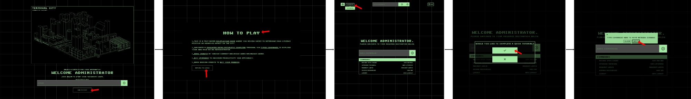
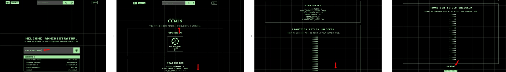
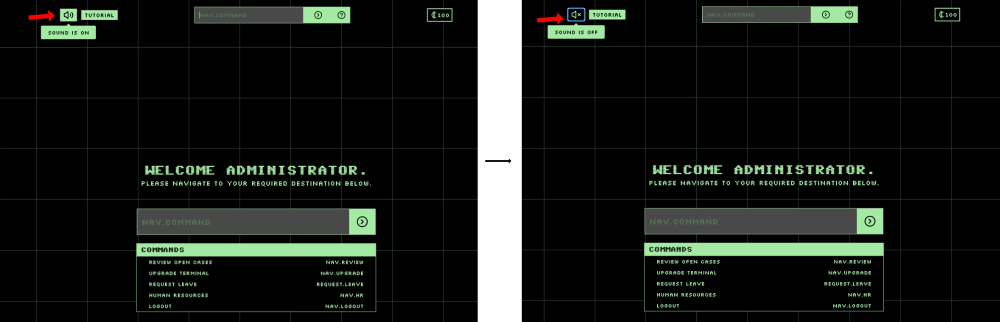
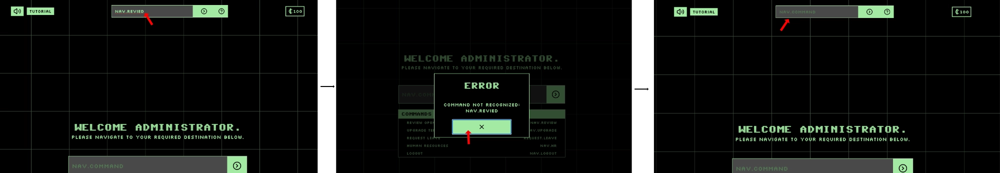
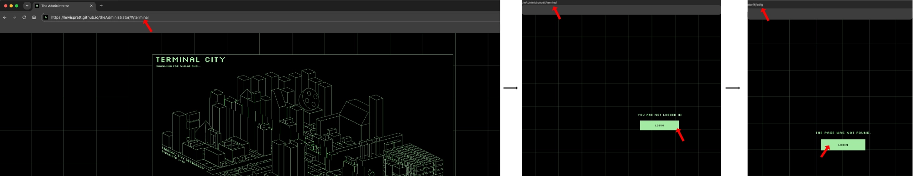
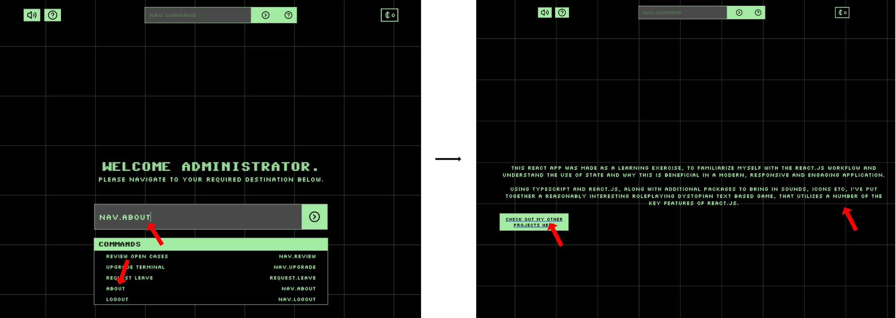

# The Administrator

# Project Summary

The Administrator is a text based role playing game, developed in React.js. The project demonstrates the use of HTML, CSS, Javascript and most prominently, use of the React Javascript library.

The Administrator is a browser based logic game in which the user navigates a simulated retro computer system, passing judgement on citizens, earning currency and purchasing upgrades to improve the efficiency and speed of the cycle. The end goal is to unlock all senior Administrator titles, at which point the user is finally considered to have completed the games content.

Live Site: [The Administrator Login Page](https://lewispratt.github.io/theAdministrator/)

## Table of Contents

- [The Administrator](#the-administrator)
- [Project Summary](#project-summary)
  - [Table of Contents](#table-of-contents)
  - [Pages Overview](#pages-overview)
  - [Technologies Used](#technologies-used)
  - [Why React?](#why-react)
  - [Terminology](#terminology)
  - [UX Design](#ux-design)
    - [Project Goals](#project-goals)
    - [Key thematic choices](#key-thematic-choices)
    - [Target Audience](#target-audience)
    - [Audience Goals](#audience-goals)
    - [Developer Goals](#developer-goals)
    - [User Stories](#user-stories)
  - [The following user stories describe the key ways in which the site may be used, from the perspective of different users.](#the-following-user-stories-describe-the-key-ways-in-which-the-site-may-be-used-from-the-perspective-of-different-users)
    - [User Story 1 - Casual browser game player](#user-story-1---casual-browser-game-player)
      - [Acceptance Criteria](#acceptance-criteria)
      - [Tasks](#tasks)
      - [Visual Journey](#visual-journey)
    - [User Story 2 - Casual browser game player](#user-story-2---casual-browser-game-player)
      - [Acceptance Criteria](#acceptance-criteria-1)
      - [Tasks](#tasks-1)
      - [Visual Journey](#visual-journey-1)
    - [User Story 3 - Casual browser game player](#user-story-3---casual-browser-game-player)
      - [Acceptance Criteria](#acceptance-criteria-2)
      - [Tasks](#tasks-2)
      - [Visual Journey](#visual-journey-2)
    - [User Story 4 - Prospective Employer](#user-story-4---prospective-employer)
      - [Acceptance Criteria](#acceptance-criteria-3)
      - [Tasks](#tasks-3)
      - [Visual Journey](#visual-journey-3)
    - [User Story 5 - Prospective Employer](#user-story-5---prospective-employer)
      - [Acceptance Criteria](#acceptance-criteria-4)
      - [Tasks](#tasks-4)
      - [Visual Journey](#visual-journey-4)
    - [User Story 6 - Prospective Employer](#user-story-6---prospective-employer)
      - [Acceptance Criteria](#acceptance-criteria-5)
      - [Tasks](#tasks-5)
      - [Visual Journey](#visual-journey-5)
  - 
  - [User Story Outcomes](#user-story-outcomes)
  - [Wireframes](#wireframes)
  - [Design \& Style](#design--style)
    - [Styling](#styling)
    - [Fonts](#fonts)
    - [CSS Animations](#css-animations)
    - [Favicon](#favicon)
  - [Key Features - Design \& content](#key-features---design--content)
    - [Dynamic Content](#dynamic-content)
    - [Loading screens](#loading-screens)
  - [Accessibility](#accessibility)
    - [Pages](#pages)
  - [Technical Decisions](#technical-decisions)
    - [File structure](#file-structure)
    - [Local storage](#local-storage)
    - [Styling](#styling-1)
      - [Fonts](#fonts-1)
      - [Images](#images)
  - [Colour](#colour)
    - [Layout](#layout)
      - [Content hierarchy](#content-hierarchy)
      - [Flex box](#flex-box)
    - [JavaScript](#javascript)
    - [Accessibility](#accessibility-1)
  - [Challenges \& Problem Solving](#challenges--problem-solving)
    - [API integration and error handling - Dice Bear Avatar Generator](#api-integration-and-error-handling---dice-bear-avatar-generator)
    - [No Error](#no-error)
    - [API image not loading](#api-image-not-loading)
    - [API image not loading and default avatar not loading](#api-image-not-loading-and-default-avatar-not-loading)
    - [Citizen Avatars](#citizen-avatars)
    - [Use of generative ai](#use-of-generative-ai)
    - [Page Deployment](#page-deployment)
  - [Vite](#vite)
    - [Use of SVG graphics in city map component](#use-of-svg-graphics-in-city-map-component)
    - [Form Validation and Security](#form-validation-and-security)
    - [Form accessibility](#form-accessibility)
  - [Code Validation](#code-validation)
    - [CSS](#css)
    - [HTML](#html)
    - [Javascript](#javascript-1)
  - [Compatibility](#compatibility)
  - [Testing](#testing)
  - [Lighthouse Testing](#lighthouse-testing)
  - [Node Packages used](#node-packages-used)
  - [Credits](#credits)
  - [Author](#author)
  - [Deployment](#deployment)
  - [Additional Reading References](#additional-reading-references)

## Pages Overview

--

## Technologies Used
* HTML
* CSS
* Javascript (Vanilla)
* React.js
* Vite
* Google Fonts
* Lucide Icons (Node package)
* React Tooltips (node Package)
* React sounds (node package)

## Why React?

React is ideal for the purposes of a browser based game, as it champions the use of state and conditional rendering to display relevant information to the user. It is also component based, meaning the structure and content of a React website is split into multiple components of varying sizes and complexity. This component based structure allows for the easy re-use of key parts of UI across the project.

This project was created as part of my Web Application Development Diploma (Milestone project 2), which required the inclusion of Javascript to add interactivity to a website. With the use of React, I have been able to create a web app that has Javascript at its core and includes a significant amount of interactivity for users. React is a very popular library, used by many organizations in the industry, so I was keen to up-skill myself in this area.

## Terminology

- As a React web app, the project is essentially a single page website that has it's content loaded dynamically via Javascript. For this reason, when referring to a 'component' or 'component view', the developer is referring to what a user would normally perceive of as a page.
- When referring to a 'logged in' user, the developer is referring to a user who has entered a name into the login components input and has progressed through the welcome screen to the logged in state of the web app. Once 'logged in' the users data is loaded from local storage and they can access the main content of the app.

## UX Design

### Project Goals

The primary goal of The Administrator is to provide a visiting user with an visually and intellectually interesting experience, which challenges the players logic skills as well as promoting curiosity and problem solving through the gradual use of upgrades to enhance gameplay. The web app is primarily a means of entertainment rather than utility, therefore relying heavily on the game logic to perform as expected and reliably.
The web app also serves as a more complex portfolio piece for the developer, showcasing an understanding of the principles and techniques used within a React based app.

### Key thematic choices

- The web app has been designed from the beginning with the idea of being able to navigate the entire experience via keyboard alone. For this reason, every interactive element throughout the app has had the `tabindex` attribute assigned to it to ensure that there is seamless access via the keyboard.
- The primary method of navigation between pages is via the use of typed commands, rather than the traditional method of clickable links. Clickable links are present within the app, however they are few and only serve as a means of convenience when relying purely on keyboard navigation would prove impractical. Available keyboard commands are visible within every component view and are easily memorized after a short time of playing. Implementing this concept of keyboard navigation aligns with the developers vision of providing a simulated retro-futuristic computer console environment, similar to those depicted in popular media which either use primarily voice or keyboard input for navigation and overall control.
- When visiting the apps front page, there is a login screen that new and returning users enter there name to access the rest of the app content. This is effectively a faux login screen, as there is no password or authentication in place. Utilizing this login flow is primarily a method of loading saved player data, or warning the player that they will overwrite saved data if they have entered a new login name.
  It is also part of the theme of the game, as the user is playing the role of an administrator, so it makes thematic sense for them to login to their system when they visit the app.

### Target Audience

There are 2 main audiences for the web app:

- Users who wish to explore a casual thematic browser game that runs on both mobile and desktop.
- Prospective employers who wish to view the developers work and gain more insight into the developers ability and other projects.

### Audience Goals

- Casual players
  - To know what the web app is when visiting it for the first time and be shown how to play the game when playing it for the first time.
  - To view statistics about gameplay and manage stored game data
  - To know the end goal of the game loop and how to reach it as well as how to purchase upgrades in game and what they do.
  - To gain an understanding of what makes a Citizen within the game either good or bad.
  - To be able to control sound produced by the app.

- Prospective employer
  - To understand what the web apps purpose and use is
  - To see that form validation is implemented and managed effectively.
  - To see that player data loading is implemented logically and guard against unintended viewing of component content when the player has no player data loaded.
  - To be able to visit the developers other projects and Git repositories.
  ***

### Developer Goals

- The web app should adhere to a strict aesthetic theme that simulates a retro computer terminal environment, often seen in science fiction movies and literature.
- The app should be able to store player progress between play sessions and guard against player early access causing game data loss.
- The game should not use any backend systems that require ongoing maintenance or payment in place. All game data should be stored locally on the players machine.
- Locally stored game data should be encrypted to a basic level, reducing the likelihood of players easily manipulating locally stored game data to progress in the game loop. (Whilst acknowledging that data stored in `localstorage` has its limitations, as discussed later)
- The web app should demonstrate the developers knowledge of and ability to use the three core languages of web design (HTML/CSS/JS), with code being cross-browser compatible, fully validated, tested and organized in line with industry standard practices.
- The web App should be able to demonstrate the developers understanding and ability to implement the React.js library, utilizing State, Refs, conditional rendering and other key functions of the React library.

### User Stories

The following user stories describe the key ways in which the site may be used, from the perspective of different users.

### User Story 1 - Casual browser game player

(Must Have)

I am a new user who wants to know what this website is when visiting it for the first time and how to play.

#### Acceptance Criteria

- [x] The first page that the user sees should have a clear call to action, helping new users access the desired information.
- [x] Information should be accessible to access via conventional peripherals or accessability aids.
- [x] The description content should be short and useful to a new user.
- [x] There should be an easy way to return to the front page of the web app.
- [x] When logged in there should be an easy to follow explanation of how to play.

#### Tasks

- [x] Provide a clear Call to action button, highlighting where to go for information on the app.
- [x] Ensure that the call to action is accessible via both mouse input and keyboard input.
- [x] Provide a concise and accurate explanation of the core concepts of the game loop and purpose of the web app.
- [x] Add clear call to action button to return to the front page of the app.
- [x] Build a tutorial that walks players through each part of the app and explains key design and gameplay concepts.

#### Visual Journey

### User Story 2 - Casual browser game player

(Must Have)

I am a returning player and want to see statistics on my actions within the game as well as delete my stored game data if i wish to

#### Acceptance Criteria

- [x] There should be an easily identifiable location for personal statistics information once a players data is loaded.
- [x] Player statistics and unlocks should be easily identifiable and clearly defined
- [x] All player data should be visible in an ordered manner on both mobile an desktop
- [x] There should be an obvious call to action to delete stored player data.
- [x] confirmation should be needed before deleting data to ensure accidental deletion doesn't occur.

#### Tasks

- [x] Build a clear component view for personal statistics and other stored player data.
- [x] Ensure that how to navigate to a players personal record is clear and easy to do
- [x] Ensure that the layout for the personal record component view is responsive and clear in determining the different categories of player data.
- [x] Provide a call to action button to allow players to delete stored data.
- [x] Build a confirmation state to ensure that once pressed, the player needs to confirm their decision to delete the stored data.

#### Visual Journey

### User Story 3 - Casual browser game player

(Must Have)

I would like to be able to control the use of sound within the app.

#### Acceptance Criteria

- [x] There should be an easily identifiable route to disable/enable sound within the app.
- [x] No key gameplay mechanics should rely on the player being able to hear the sounds being made by the app.

#### Tasks

- [x] Utilize react compatible package to implement the use of sound throughout the app.
- [x] Ensure that all component views of the app are covered by the sound controls (ensuring that muting sound in one view means it is muted in all views)
- [x] Add a clear call to action that easily toggles the use of sound within the app.
- [x] Provide feedback to the user to inform them as to the current state of sound within the app (either on or off)
- [x] Ensure that the call to action button is accessible to adaptive technologies.

#### Visual Journey

### User Story 4 - Prospective Employer

(Must Have)

I would like to ensure adequate safeguards are in place to manage navigation input submissions effectively

#### Acceptance Criteria

- [x] When a text input is submitted, if the content is not recognized or does not have an effect, the user should be informed of this as an error.
- [x] Navigating to pages via the use of direct URL manipulation should produce a predictable response. If the user is logged in, gameplay elements should be visible, if the user is not logged in, the user should be re-directed to the login page.

#### Tasks

- [x] Implement component switching logic that covers all navigation routes included made abaialble to the user.
- [x] Add catch to switching logic that catches any routes that are not recognized (due to not existing or misspelling)
- [x] Use an error state to conditionally render a warning to the user, informing them that the command they entered was not recognized.
- [x] Provide a button to dismiss the warning and reset the error state

#### Visual Journey

### User Story 5 - Prospective Employer

(Must Have)

I would like to ensure adequate safeguards are in place to manage direct URL manipulation.

#### Acceptance Criteria

- [x] Game logic and data should not render for a non logged in user when they have navigated to a component view via the URL directly.
- [x] If a non-logged in user navigates to a component view that requires logged in status, they should be re-directed to log in and load player data.

#### Tasks

- [x] Implement the use of session token data to check whether the user has been logged in.
- [x] Set user as logged in using session storage when they successfully login.
- [x] Check in each component view to see if use is currently logged in. Conditionally render content dependant on logged in status.
- [x] Implement call to action to redirect to login if not logged in.
- [x] Manage session cleanup when user logs out, clearing logged in status.

#### Visual Journey

### User Story 6 - Prospective Employer

(Must Have)

I would like to see the rationale for this project and view the developers other projects.

#### Acceptance Criteria

- [x] Navigation command for this content should be obvious and logical
- [x] Rationale content should be concise and easy to read.
- [x] Link should be provided to developers other projects

#### Tasks

- [x] Implement navigation command (nav.about) to allow users access to this component view
- [x] Include a brief description of the project and why it was created
- [x] Add clear call to action button to link to developers other projects.

#### Visual Journey

## 

### User Story 7 - Casual browser game player

(Could Have)

I would like to be able to create two player accounts for the game and save their game data separately, ensuring that one players data is not overwritten by the others. 

#### Acceptance Criteria

- [ ] Login page should allow the creation of additional players without the overwriting of previous players data
- [ ] When the second player logs in, there should be no indication that there is another players data saved in local storage.
- [ ] Each individual player should be able to delete their own stored data without risk of effecting other players data. 

#### Tasks

- [ ] Implement check at login to determine if player is returning or new. 
- [ ] If player is new and there is no other data stored, login as usual. 
- [ ] If player is new and there is previous save data, save data alongside previous players data and login
- [ ] Save all game data to the currently logged in player, without impacting on other players saved data. 

## User Story Outcomes

During development, all Must Have user stories were implemented successfully. user story 7 was classed as a 'Could Have' feature due to it not being essential for the overall gameplay loop. 
I decided during development that the use case for being able to save multiple users data on the same machine is very limited and not likely to become an issue for the majority of users who would access the app. 
By weighing the cost/benefit of developing this feature, I decided that it was not essential so would not be present in the current project, but could be implemented at a later date. 

Not including this feature in the current release of the project does not impact the core gameplay loop or have an adverse effect on user experience as it is unlikely that two people using the same device would wish to play the game separately. 

## Wireframes

## Design \& Style

--

### Styling

CSS files were created for each component that represents a 'page' within the app. Only CSS rules that pertain to that component are imported into the component. Some CSS rules are global so have been placed in app.css and imported where necessary.

### Fonts

--

### CSS Animations

--

### Favicon
 
A simple Favicon was created using Affinity Designer and converted into the correct format for use (.ico)

## Key Features - Design \& content

### Dynamic Content

Throughout the app, I have used dynamic content to create immersion and ensure that the likelihood of receiving the same content is low on repeated play-throughs. Without the use of a back-end system, this has been achieved through constructing JavaScript objects that hold a large number of individual datasets
that can then be randomly combined to create unique data sets.
The most significant implementation of this concept is within the person class which constructs each citizen that the user assesses in the case review part of the app.
Individual objects that hold possible character names,occupations,carried items, interview locations and citizen flavour text (text within their case notes that is generated to give an overall description of the citizen) are combined with a randomization utility function to produce unique citizen interviews on each play-through.

For simple effects and components that are primarily cosmetic, a simple randomization utility function such as the below has been used.

    Function randomChance(threshold :number) : Boolean{
     If(math.floor(math.random()*10)+1 < threshold){
          return true
      } Else {
          return false
      }
    }

This will produce a number between 1-10 and if that number is under the `threshold` variable, will return true.

### Loading screens

At a number of transition points( moving from one route to another) faux loading screens have been implemented to simulate the use of a desktop terminal. These screens aren't necessary for the function of the application, however they do add to the theming, pacing and world building. They have been achieved through the use of state within the relevant pages and `settimeout `to change state after a set period of time (2 seconds). This timer, through repeated play tests, feels reasonable in achieving the goal of the loading screen, but does not feel like it slows the pacing detrimentally.

## Accessibility

Due to the theme of the app I have made, accessibility, for the most part, was being addressed throughout the project mainly due to my idea that the entire experience should be navigable and playable whilst solely using a keyboard. Many of the computers shown in reference images and films that I explored, such as bladerunner, often don't have a mouse or equivalent connected and much if not all of the navigation and interaction is achieved via the keyboard alone.
This has meant that from the beginning of my project, I have focussed on ensuring all interactive elements are accessible to both mouse and keyboard, providing visual feedback when an interaction occurs.

The intended experience for the user is for navigation to be undertaken via typed commands, keeping in line with the simulated computer system theme. 
However, it is also important to ensure that users who do not have access to a keyboard, can still move around the app effectively. For this reason, The available commands component, positioned next to the navigation input at the top of the page, provides a list of the commands to move between component views. These commands are buttons that can be used to navigate around the app if the user cannot, or does not wish to use the typed navigation commands. 

### Pages

--

## Technical Decisions

### File structure

Due to the nature of developing a React app (often creating large numbers of small self contained components) it has been important to ensure the file structure throughout development has been manageable. Once the project got to a point of over 30 individual components of varying sizes, I decided to prioritise future legibility of the file structure and divide the components into meaningful sub directories that would support easy access during ongoing development.

### Local storage

Local storage has been used as a means of persisting users game data between sessions. This data stores information on their administrators name, cases reviewed, credits earned and unlocks purchased. As this data is being stored locally, when the user first visits the app, they will be asked if they consent to this process. If they do not, the only effect this will have on the game is data persistence between play sessions (closing or refreshing the tab the game is being played in will reset the game state to being logged out with no saved progress)
Players are able to delete local storage related to the app easily through the profile route. They can also have multiple data sets stored locally by using a different administrator name when logging in.
Local storage has been used in place of a full backend system (database) to allow game progress to persist between gaming sessions. This has been implemented with the full knowledge that this data stored locally is easily located and changed by the user, effectively allowing them to cheat the game. For this reason, the app has been developed from the start as a casual gaming experience for players.
### Styling

#### Fonts

To align with the retro futuristic aesthetic of the game, I chose to utilise a pixelated font for the majority of the body content, combined with a stylised 'scan line effect' font for headings.

Body and paragraph elements utilised
font-family:'Silkscreen',monospace

#### Images

All images have relevant and useful alt text in the event they either cannot be rendered or if a user is utilising a screen reader.
Images have been re-sized to both provide high quality visuals as well as ensure minimal impact on loading. Where image file size savings can be made by converting to webp, this has occurred, however not all images have seen significant file size changes so some remain in their original format (PNG).

## Colour

using `<meta name="theme-color" content="#000000">` to set the colour of mobile browser address bar to fit the color scheme of the app.
The retro futuristic aesthetic I decided to utilise for this game allowed me the freedom to be creative with the colour pallete throughout the app. When researching UI examples and references from films I noticed that most computer systems set in a dystopian, authoritative universe, tended towards a simple high contrast colour scheme that didn't distract from the content. Choosing two primary colours and allowing the use of slightly altered brightnesses of these two colours, ensured that there was a cohesive, thematic and consistent feel to the entire application. The colours I chose as my two primary colours enhance the overall theme of the app and contribute to achieving its purpose.
My initial concept was to create a simulated computer terminal in a retro futuristic setting. Simulating a system that runs on a low tech computer terminal that only renders two colours (at varying degrees of brightness) helps to further enhance the theming of the app.
Contrast however is important, particularly when committing to the use of only two colours. For this reason I used ..... To check the contrast value between my two primary colours and the result showed a pass with high contrast at .....
With the use of only two colours, it was also important to ensure that similar/identical elements that appear across different components are styled consistently to ensure that calls to action (CTA) and other important elements are easy to identify and navigate.

Applying colour to external library components:
The React tooltips package was used to integrate tooltips into the app. As standard the default styling of these tooltips was not in line with the styling applied to the rest of the app.
In order to style tooltips successfully, the documentation advised that tooltips must have a higher level of specificity in order to successfully apply CSS styling rules. For this reason, all tooltips were given a class of 'custom-tooltip' and placed within the 'main-content' element to ensure that they can be targeted with a higher specificity than their default styling rules.
#main-content .custom-tooltip{
CSS rules to apply to tooltips.
}

Lucide icons package
Icons used from the lucide icons package can easily be styled by applying a custom class to them, effecting their colour, size, fill etc.
This package was used to provide icons for CTAs, carriable items and faux loading screens.

### Layout
#### Content hierarchy

The use of appropriate headings (H1,H2,H3 etc) helps to direct the flow of page content as well as highlight important information to the user.
Semantic html has been used to divide each component into appropriate sections and organise elements logically and consistently.

#### Flex box

Flex box has been used throughout the app to create a responsive and mobile first layout, ensuring content is adequately spaced and aligned for viewing on mobile and desktop.

### JavaScript

--

### Accessibility

--

## Challenges \& Problem Solving

### API integration and error handling - Dice Bear Avatar Generator

To add additional character and visual interest, an external API was used to provide unique avatars for the citizens encountered in the course of the game.
[Dice Bear API](https://www.dicebear.com/) was used to easily generate random avatars to use within the case review section of the site. Each case that is reviwed as part of the gameplay loop, is linked to a fictional Citizen that has been encountered within the city. Adding an avatar to their case notes adds further depth and interest to the experience.

There are a number of ways to integrate the Dice Bear avatar generation into a project, but i chose to utilize the HTTP api method due to its simplicity and ease of implementation, reducing the need to rely on additional packages in the project.

The Dice Bear API does not need authorization and returns a single item, a URL to the generated avatar image.

Relying on an external API however, means that there is a chance for calls to the API endpoint to fail, resulting in no avatar image being displayed. If this eventuality was not guarded against, it would result in unattractive missing image icons as well as alt text being visible within the UI, ruining the sense of immersion. As API endpoints can experience downtime or, in extreme cases, stop working all together, it is important to have contingencies to manage these eventualities if they arise.

For this reason, there are 3 separate states that the avatar component can present in.

### No Error

If the Dice Bear endpoint is working as expected and returning and image that can be loaded within the `` tag, the randomly generated avatar will display as desired.

### API image not loading

If, for whatever reason, the image being provided by the Dice Bear endpoint is not loadable, or the endpoint url is incorrect, the `` element `src` attribute will not be valid, producing an error that can be detected via Javascript and handled.
Once detected, this error handler will set the image `src` attribute to the url of the default avatar file.

### API image not loading and default avatar not loading

In the unlikely occurence that both the API is unsuccessful at providing an image, as well as the default avatar image file being un-loadable, the error handler will further ensure that the avatar fails gracefully and set css attributes within the avatar component to maintain an acceptable fallback.

The error handling that has been implemented in using this API should cover all possible points of failure, ensuring that the UX is not negatively impacted by potential issues encountered when relying on external API endpoints.

         {
          if (e.currentTarget.dataset.default != "set") {
            e.currentTarget.src = "default-avatar.webp";
            e.currentTarget.dataset.default = "set";
          } else {
            if (e.currentTarget.parentElement) {
              e.currentTarget.parentElement.style.cssText =
                "background-color: #a2eaa2;";
            }
            e.currentTarget.before("Avatar Not Found");
            e.currentTarget.alt = "";
          }
        }}
      />

Above is the image element for a Citizen Avatar. There are a number of notable characteristics to highlight.

1. the image `src` attribute is set to the Dice Bear image url from the current transcript being processed.
2. the `data-default` attribute allows the error handler to mark this image as 'having been dealt with' after attempting to set the image `src` to the default avatar url. If this attribute is empty and the initial `src` cannot be loaded, the error handler will attempt to set the `src` to the default avatar url. If `data-default="set"` the error handler will not attempt to set the src again (this loop can occur if both the initial src and the backup, default avatar, are not loadable.)
3. `onError` triggers when an error occurs whilst this element tries to load the `src` it has been provided.
4. The error handler will attempt to set the default avatar if the primary `src` is un-loadable. if both of these are unsuccessful, it will then apply css styling to the parent container of the image element, serving as a further fallback. Removing the `alt` attribute content removes the missing image icon, however the same information is given by the styles applied by the error handler.

I created a default avatar image that was in line with the style of the avatars provided by Dice Bear. This was exported as a webp file to ensure small file size and good quality.

)

### Citizen Avatars

Each citizens avatar is generated randomly from the Dice Bear API, however, depending on the citizens gender, they access different endpoints. This is in order to generate a realistic representation of each citizen (generating female presenting avatars for females, males presenting avatars for males and either for synths.)
This is achieved within the person class when each citizens data is generated and their gender and behaviour are used to conditionally select which API endpoint their avatar is pulled from.

    if (gender === "male") {
      if (behaviour.toLowerCase() === "compliant") {
        imageUrl = mensHappyUrl +uuidv4();
      } else if (behaviour.toLowerCase() === "non-compliant") {
        imageUrl = mensAngryUrl +uuidv4();
      } else {
        imageUrl = mensNeutralUrl +uuidv4();
      }
    }

each endpoint url has a seed value at the end, so appending `uuidv4()` to the url ensures that each avatar that is generated is a unique image.

Filtering the citizens by gender and behaviour allows very customizable control over the appearance of the avatars generated. For instance, compliant male citizens have avatars that include smiling and overall happy expressions combined with male traits, whereas non-compliant male citizens only have avatars that include expressions of sadness or anger and male body traits.
Removing or adding values in the url used to access the Dice Bear API allows the exclusion or addition of different expressions, hairstyles, head shapes etc. By utilizing this, the avatars that are produced are random, but they also contribute to the mechanics of the game as it is easy to now see whether a citizen in happy, sad or indifferent, which impacts on each citizens weighting.

### Use of generative ai

As a means of efficiency, generative ai was used to populate js objects that hold large datasets used in content randomization.
Prompts such as
"Generate a JavaScript array of 100 first names that would fit the theme of a retro futuristic city"
This would result in a dataset with 10000 unique combinations of first and last names.
Similar prompts were used to produce datasets for last names, occupations and locations.

LLMs we're also used as a means of troubleshooting and dissecting new coding concepts that were unfamiliar.

No LLM generated code snippets or automated deployment models were utilized in the creation, implementation and completion of this project.

### Page Deployment

## Vite

Vite was used to initially scaffold the project as well as build the user facing content once ready for deployment.

### Use of SVG graphics in city map component

Having had very little experience with svg graphics in the past, I was keen to ensure I expanded my knowledge in this area whilst completing this project. Whilst exploring reference images, I came across a number of UIs that featured a wireframe type city map as a focal point and felt this would be a great fit for my app.

I created the initial wireframe city image in Affinity Designer, saving it as a png file, then created an SVG within my city map component, using the png as a backdrop to the subsequent SVG elements. Using transparent overlays (also created in Affinity Designer) I created 'hotspots' on top of the city image using the <path> element. These hotspots were then targeted by CSS:hover rules to interact with the user when they move their mouse over each hotspot on the map. These hotspots were also given a tab index value of 0 to allow keyboard users to acees this interactivity. Using the value of 0 assigns each element a tab index based on it's position within the DOM.
Each hotspot was also assigned a tooltip that shows the name of the district it is highlighting.
I wanted to make the city map feel active and alive, rather than a static image. To do this I decided to implement a scanning effect which sweeps a 'scan line' across the city and simulates scanning of the entire city.

This was achieved by first drawing a path across my city image in Affinity Designer, then using the path coordinates within my svg to draw an invisible line across the centre (diagnonally) of my city image. I then created a clipPath that was applied to a duplicate of the original city image. This duplicate image has it's brightness adjusted via
Filter:brightness(2)

And is offset slightly on the X and Y axis. A rectangle is then attached to the clipPath and using the animateMotion feature of the SVG, the rectangle is moved along the path drawn in Affinity Designer, showing as small slice of the duplicate image as it passes over the city. This simulates the scan line having an effect on the brightness and structure of city map image.

I created text elements within the SVG parent and positioned these to align with the city map. The text elements provide further theming and world building character to the login page and, as they are not part of the city map image, their visual presentation is not impacted by the scan line effect.
SVGs are self contained and scalable, meaning that the styling of all elements within the SVG are static between the desktop and mobile experience. Without using svg graphics, creating hotspots on top of an image and ensuring it had a consistent presentation both in mobile and desktop viewing, would be overly complicated, inconsistent and essentially ineffective. The combination of ensuring a properly scaled image as well as precisely placed hotspots, would be prohibitively complex and inaccurate due to changing margins and scaling. SVG graphics are the ideal solution for this feature, with the added benefit of providing self contained methods of element animation and styling

### Form Validation and Security

--

### Form accessibility

--

## Code Validation

### CSS

--

### HTML

--

### Javascript

--

## Compatibility

--

## Testing

| Feature | Chrome | Firefox | Safari | Edge | Mobile |
|---|---|---|---|---|---|
| Typed Navigation | ✅ | ✅ | ✅ | ✅ | ✅ |
| Error/confirmation overlays | ✅ | ✅ | ✅ | ✅ | ✅ |
| Favicon | ✅ | ✅ | ✅ | ✅ | ✅ |
| Page not found | ✅ | ✅ | ✅ | ✅ | ✅ |
| Missing session Token | ✅ | ✅ | ✅ | ✅ | ✅ |
| Missing local storage user data | ✅ | ✅ | ✅ | ✅ | ✅ |
| 

--

## Lighthouse Testing

--

## Node Packages used

- lucide icons
- react tooltips

## Credits

--

## Author

--
## Deployment

--
## Additional Reading References
Whilst developing this site, additional reading was undertaken to primarily around using React.js, as it was a new technology to me at the start of the project. 

Javascript / React - https://www.w3schools.com. When searching online for additional details around using the React library and other vanilla Javascript functionality, w3schools was utilized to gain a high level understanding of the code. W3 provides very good, short descriptions and examples of how specific pieces of code can be used, as well as linking to additional reading that may contribute to fully understanding it's use.

The main additional reading resource i accessed during this project was the official [React.dev](https://www.react.dev) website, which has a very user friendly and logical approach to onboarding new users to the library. 
No structured tutorials or walk-throughs were used during the building of this web app.

Large language models were only used as a means of troubleshooting when i was not able to identify the cause of an error through my additional reading. When using LLMs, prompts were always prefixed with the context of "not providing code snippets to solve the error" as this is not a helpful way to improve my own understanding of the code. Responses received from LLms were questioning and of a problem solving nature, rather than immediately solving the error i was encountering by providing code snippets. 

